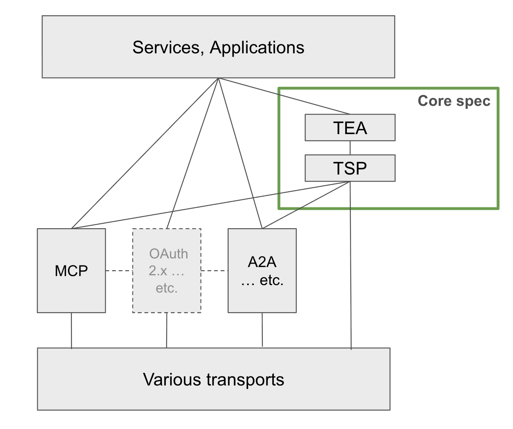
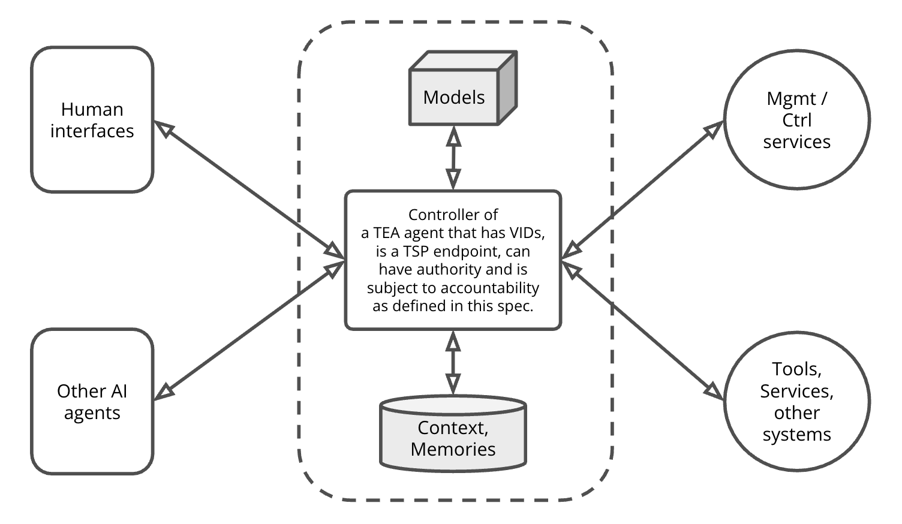
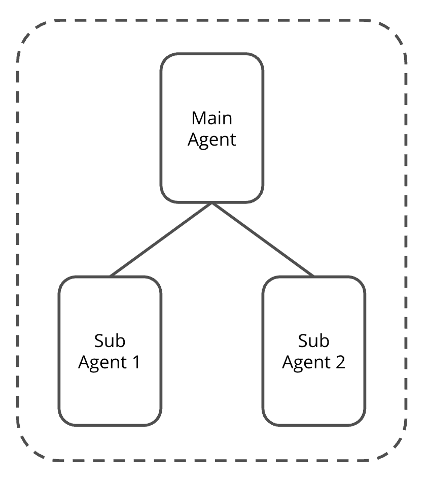
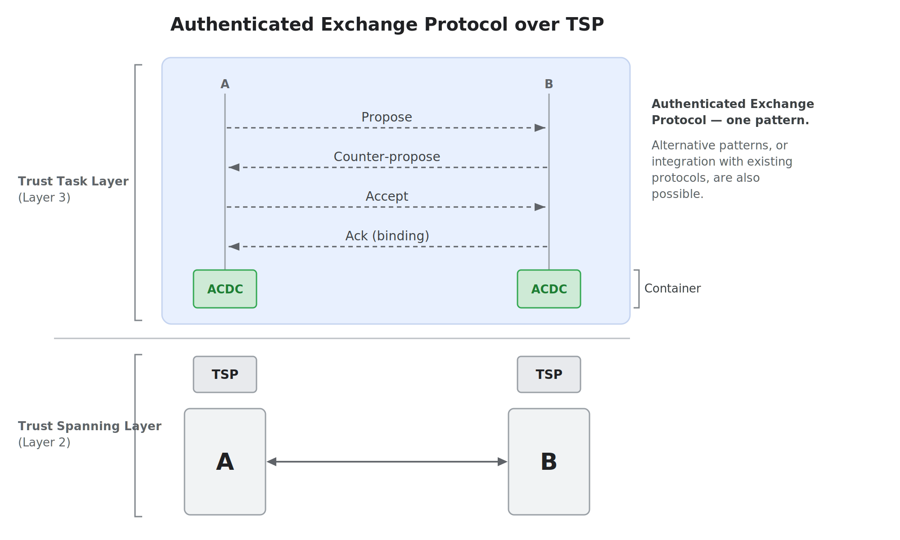
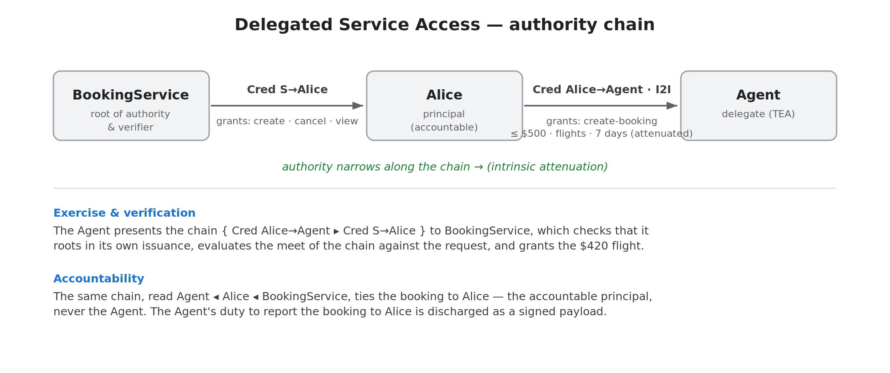

[//]: # (Pandoc Formatting Macros)

[//]: # (Main content {#sec:content})

## TEA Reference Framework

Trust-Enabled Agents (TEAs) are agents whose identity, authority and accountability are verifiable by their counterparties. A TEA holds Verifiable Identifiers (VIDs) and negotiates, delegates, exercises and accounts for authority with other TEAs over the Trust Spanning Protocol (TSP) [1]. This specification defines TEA as a set of Trust Tasks over TSP.

<figure id="protocol-layering">
  
  <figcaption>Figure 1: Protocol layering</figcaption>
</figure>

&nbsp;

Every TEA message is a TSP message, sealed by TSP between the sender's VID and the receiver's VID. TEA relies on TSP for authenticity, integrity and confidentiality, and defines nothing that duplicates them.

In short: TEAs are TSP-enabled agents speaking to each other.

### Structure of a TEA

<figure id="tea-reference-framework">
  
  <figcaption>Figure 2: TEA Reference Framework</figcaption>
</figure>

&nbsp;

A TEA is a TSP endpoint. It consists of a Controller, which holds the TEA's VIDs and keys in a Wallet and sends and receives all TSP messages through a TSP Gateway, together with zero or more AI models and memory modules whose access to context, memory and tools passes through the Controller. The Controller is the unit to which authority is delegated and accountability is assigned.

The entities around a TEA, such as users and their interfaces, management services, tools and other agents, MAY themselves be TSP endpoints, in which case they participate as TEAs. A TEA MAY be composite, as in [Figure 3](#composite-tea); a composite TEA is represented by one VID for the purposes of this specification, and that VID is where authority is delegated to and accountability assigned.

<figure id="composite-tea">
  
  <figcaption>Figure 3: Composite TEA</figcaption>
</figure>

&nbsp;

## TEAs

This section defines what an agent needs to be a conformant TEA.

A TEA is a TSP endpoint [1]. It MUST be a distinct domain of control, so that authority and accountability can be attributed to it uniquely.

1. The TEA MUST contain a Controller that is a conformant TSP endpoint. All access by the TEA's AI models to context, memory and tools within the TEA MUST pass through the Controller. A remotely served model's own context outside the TEA is part of that model's behaviour and is out of scope.
2. The Controller MUST contain a Wallet: a secured data store holding the TEA's VIDs, their keys, and the signed records the TEA relies on. Only the Controller accesses the Wallet. Its implementation is addressed in [Security and Trust Considerations](#security-and-trust-considerations).
3. The Controller MUST contain a TSP Gateway, through which all TSP messages pass. The TSP Gateway MUST support TSP's confidentiality function and both the NaCl and HPKE modes, and MAY support TSP's metadata-privacy function.
4. The Controller MAY have communication channels other than the TSP Gateway, including an agent protocol's ordinary traffic. Content received over such channels is unauthenticated input: it carries no TEA assurance and is handled under [Model containment](#model-containment).
5. The Controller MUST have one or more VIDs, and MUST publish at least one of them so that first contact can be made without a prior relationship. Authority is delegated to, and accountability attaches to, the VID a TEA uses in an exchange. A TEA MAY use different VIDs with different counterparties, and a VID need not be published.
6. The Controller MUST implement the Delegation, Invocation and Continuing Exchanges and the Accountability requirements defined in this specification.

### Verifiable Identifiers (VIDs)

A VID is an identifier whose controller can prove control of it, and whose key history is verifiable by any party, independently of who operates the service that publishes it. A VID MUST support key rotation and pre-rotation, with the history of rotations verifiable.

The TEA MUST support **did:webvh** [ref], including its pre-rotation feature. Other VID types MAY be supported.

## TEA Message

Everything a TEA says to another TEA is said in TEA messages. A TEA message is a TSP message [1] sent from the sender's VID to the receiver's VID, whose payload is a **TEA Container**. The exchanges defined later are sequences of TEA messages; they define message types and their content, and nothing else about the message.

### TEA Container

A TEA Container has the structure of an Authentic Chained Data Container (ACDC) [ref], with one departure: wherever ACDC uses a KERI Autonomic Identifier (AID), a TEA Container uses a VID. This affects the issuer field `i`, the issuee attribute `a.i`, the edge operators that compare them (for example I2I), and the revocation registry `rd`, whose key state and status are resolved through the VID rather than a KERI event log. A TEA Container is therefore not an ACDC in the literal sense, and this specification uses the term TEA Container, or Container, throughout. Where this specification is silent, the structure and semantics of ACDC apply.

A TEA Container has the following fields.

| Field | Content |
|---|---|
| `v` | Version string, as ACDC defines: protocol version and, for the JSON, CBOR and MsgPack serializations, the serialization kind and size. A Container in native CESR is framed by CESR instead. |
| `d` | The SAID of the Container. This is the identity of the message. |
| `i` | The sender's VID. |
| `s` | The SAID of the schema of the message's **type**. Each exchange defines its types by their schemas. |
| `a` | Attributes. MUST contain `dt`, the sender's timestamp, in the datetime form ACDC defines. The remaining attributes are defined by the type. |
| `e` | Edges. SAID references to other Containers, named as the type defines, for example the Propose an Accept accepts, or the capability chain an exercise relies on. |
| `r` | Rules. Present only where the type defines obligations. |

A Container MAY use the selective-disclosure and graduated-disclosure forms of ACDC.

### Requirements

1. A TEA message MUST be sent over TSP from the VID in `i` to the receiver's VID. TEA relies on TSP for authenticity to the receiver, integrity and confidentiality, and MUST NOT re-implement them.
2. A TEA message is identified and referenced by its SAID `d`. Any reference from one TEA message to another MUST be an edge in `e` carrying that SAID.
3. Two Containers from the same sender MUST NOT have the same SAID. A receiver MUST NOT act more than once on Containers with the same SAID.
4. **Signature.** Every Container MUST carry the sender's signature over `d`, produced under the key state of `i` and attached as CESR attachments. A verifier MUST recompute `d` and confirm it, resolve the key state of `i` in effect at `a.dt` within a defined clock-skew tolerance, and verify the signature against that key state.
5. Containers signed by other VIDs MAY be carried inside a message as content, for example the links of a capability chain. They prove what their signers said, not who sent the message that carries them.
6. The signature in requirement 4 is in addition to TSP message-level authentication, not a substitute for it.

Every Container is therefore a transferable proof of what its sender said, verifiable by any party that can resolve the sender's VID, not only by the receiver. This is what TSP's receiver-only authentication does not provide, and what authority and accountability require.

### Trust Tasks

The exchanges defined in this specification are Trust Tasks in the sense of TSP. A Trust Task defined elsewhere that builds on TEA MUST conduct its trust-establishing communication in TEA messages.

## Authenticated Exchange

The Authenticated Exchange is the pattern by which two TEAs negotiate what one party asks of the other and the terms on which it will be fulfilled. The Delegation and Invocation Exchanges are instances of it. Other Trust Tasks MAY follow or adapt it.

The roles are the **Initiator**, which opens the exchange, and the **Responder**. Either MAY be a composite TEA represented by one VID.

<figure id="authenticated-exchange">
  
  <figcaption>Figure 4: Authenticated Exchange</figcaption>
</figure>

&nbsp;

TSP has already authenticated the two VIDs to each other; the exchange concerns only the content of the negotiation. It uses four Container types:

- **Propose.** What the sender asks of the other party, together with the terms of its fulfilment. Either party MAY send one. A Propose with an edge to an earlier Propose in the same exchange is a counter-proposal and supersedes it.
- **Accept.** Agreement to a Propose, which it references by edge. An Accept is provisional until confirmed.
- **Ack.** The proposing party's confirmation of an Accept, which it references by edge. The Ack binds the agreement.
- **Withdraw.** Declines a Propose, or withdraws the sender's own Propose or provisional Accept, which it references by edge.

A minimal exchange is Propose, Accept, Ack. Counter-proposals in either direction MAY precede the Accept. Every message in an exchange references, directly or through its edges, the Propose that opened it; the SAID of that opening Propose identifies the exchange.

1. Only the most recent Propose in an exchange is live. A superseded Propose MUST NOT be accepted.
2. **Bounding.** A Propose MUST carry a `validUntil` by which it may be accepted. An Accept MUST carry a `validUntil` by which the Ack must be effective, set so that an Ack can be effective within it. Neither MAY be open-ended.
3. **Binding.** The agreement binds when, and only when, an Ack referencing the Accept is effective within the Accept's `validUntil`. The Ack's own `a.dt` is the time of binding. If no such Ack exists, the acceptance lapses and nothing is bound.
4. A Withdraw never binds or unbinds. It is effective only in the absence of a valid Ack; if a Withdraw and a valid Ack cross in flight, the Ack prevails. The accepting party's exposure to this is bounded by the `validUntil` it set on its Accept.
5. `validUntil` is evaluated against the sender's own `a.dt`, within a defined clock-skew tolerance. Binding turns solely on the existence of a valid Ack within the window; no comparison between the two parties' timestamps is made.

## Delegation Exchange

A Delegation Exchange is an Authenticated Exchange in which one TEA, the **Delegator**, confers authority on another, the **Delegate**, on terms both accept. The agreement is carried in a single Container of type **Capability**, issued by the Delegator to the Delegate as the Delegator's final message in the exchange. A Capability takes effect only when the exchange that issued it is bound.

Authority is delegated to, and accountability attaches to, the Delegate's VID. A Capability is issued under, and verified against, the Delegator's VID.

### What a delegation states

A delegation states policy of three kinds, separated by two questions: is it a fact the authority rests on or a duty someone owes, and is it checkable at the time of exercise or only knowable later?

| | checkable at exercise | only knowable later |
|---|---|---|
| **fact the authority rests on** | **limitation** | **assumption** |
| **duty someone owes** | — | **obligation** |

The empty cell is structural: a duty required before acting is a precondition, and a precondition is a limitation.

The **authority** is a **capability**, a triple

```
capability = ( resource, ability, limitation )
```

where the resource is which object, the ability is which operation, and the limitation is under what limits the operation may be exercised. The authorization decision, whether an Exercise is within authority, is computed only from the capability, and composes by meet down a delegation chain.

**Obligations** and **assumptions** are the **post-gate policy**. They do not enter the authorization decision and are settled after the act.

- An **obligation** is a duty one party owes to the other: to report, notify, settle, serve, or watch. Each obligation names its **obligor**. An obligation owed by the Delegate is the Delegate's exposure; an obligation owed by the Delegator, such as a duty to serve, is the Delegator's. If unmet, the obligor is answerable: a **breach**.
- An **assumption** is a fact the authority rests on that the Delegate can neither control nor observe. Nobody is obliged to make it true; if it proves false the act is undermined but no one is at fault. An assumption belongs in a Capability only if it conditions the authority.

### The Capability Container

A Capability uses the three Container sections as follows: `a` carries the capability, `r` the post-gate policy, and `e` the chain to the Capability that establishes the Delegator's own authority.

```
a:                                   # capability
  i: <Delegate VID>
  resource: <selector>               # omitted => inherit from parent
  ability:  [ ... ]                  # omitted => inherit from parent
  limitations:                       # omitted keys => no limit on that axis
    <limitation-type>: <bound>
    validUntil: <ts>                 # bounded scalar (meet = min); absent => no expiry
r:                                   # post-gate policy
  obligations:
    <label>:                         # one labeled block per obligation
      d:  <SAID of this clause>
      l:  "<rendering>"
      t:  <obligation-type>          # namespace term
      by: <obligor VID>              # the Delegate or the Delegator
      to: <beneficiary VID>
      on: <trigger>
      by_when: <deadline>
  assumptions:
    <label>:
      d:  <SAID of this clause>
      l:  "<rendering>"
e:
  auth: { n: <parent SAID>, o: I2I } # absent at a root issuance
rd: <registry SAID>                  # optional: present => revocable
```

1. A Capability MUST be issued by the Delegator, as `i`, to the Delegate, as `a.i`.
2. A Capability MUST either carry an edge to the Capability that establishes the Delegator's own authority, with the I2I operator, so that the issuer of the delegation is the issuee of the authority delegated; or be a **root issuance**, which carries no such edge and is the origin of authority over the resource. Whether a root is trusted is the relying party's decision.
3. A non-root Capability MUST carry a `validUntil` limitation; it can only shorten as authority is re-delegated. A root issuance MAY be open-ended.
4. A Capability MAY be revocable, indicated by `rd`. The registry's state MUST be resolvable through the Delegator's VID; its form is out of scope of this version. Revocation is best-effort early termination and never a substitute for `validUntil`.
5. At the time of exercise, a verifier MUST confirm that every Capability on the chain is within its validity window and, where revocable, not revoked.

### Attenuated re-delegation

Re-delegation MUST be supported to arbitrary depth, MUST allow authority to be composed from more than one source, and MUST be strictly attenuating. Attenuation is intrinsic to the encoding rather than checked.

Each capability axis is a bounded meet-semilattice: a partial order "is at most as permissive as," a meet, and a top element meaning no narrowing on that axis. The capability is their product, with meet taken component-wise, so the meet is total, deterministic, order-independent and decidable.

| axis | value | order | meet | top |
|---|---|---|---|---|
| resource | a selector over a namespace | is a sub-resource of | most specific common selector; bottom if disjoint | the whole granted namespace |
| ability | a subset of an ability vocabulary | subset | intersection | the full granted vocabulary |
| limitation | a map from limitation-type to bound | at least as tight on every type | per-type meet; absent keys are top | the empty map |

6. A re-delegation MUST be expressed as a restriction relative to its source: only the narrowed resource or ability and the limitations and obligations added at that step. An axis left unspecified is inherited unchanged.
7. The **effective capability** of a Capability is the meet of the effective capabilities reached through its edges with its own restriction. Because meet is monotone, no Capability is more permissive than any of its sources.
8. The **effective obligation set** of a Capability is the union, along its chain, of the obligations whose obligor is the Delegate at the link where they were stated. Such obligations only accumulate. Obligations owed by a Delegator bind that Delegator to that Delegate and do not accumulate down the chain.
9. Under an `AND` edge group, the effective capability is the meet across all sources, the effective obligation set is the union, and expiry or revocation of any source invalidates the composed authority. Under an `OR` edge group, an Exercise is within authority if it is within the effective capability of some currently valid source met with the restriction; it is not a join. The composed authority remains valid while at least one source is.

### Resources, abilities and limitations

The capability axes take their values from **namespaces**, owner-local or community-wide, each published and SAID-addressed. Trust in a namespace comes from the SAID, not from who serves it.

**Resources.** A resource is identified by the owner's own convention. The scheme MUST be a bounded meet-semilattice: a decidable is-sub-resource-of order, a meet, and a top. Without a decidable order a verifier cannot tell attenuation from lateral escalation. A URL path hierarchy satisfies this and is RECOMMENDED.

**Abilities.** The ability vocabulary of a resource type is defined by its owner or a community namespace. The axis is its powerset under subset.

**Limitations.** A limitation is a typed bound. Each limitation-type selects one of the value-lattice kinds defined here and supplies no meet of its own, which is what keeps the core closed:

- **bounded scalar**: meet is min, top is unbounded;
- **membership set**: meet is intersection, top is the full set;
- **interval**: meet is intersection, top is unbounded.

A limitation-type is declared in a namespace with its identifier, value domain, kind, top and rendering template.

**Profiles.** An implementation MAY write limitations in an existing policy language through a **named syntactic profile**: a published, SAID-addressed fragment of the language's grammar with its mapping into the capability core. A verifier MUST reject an expression outside the declared profile. Profiles supply syntax; the meet is this specification's.

### Obligations

Obligations form a set ordered by superset, with meet as union and top as the empty set. They are enforced through accountability, never by the authorization decision.

| field | meaning | default |
|---|---|---|
| `t` | the obligation-type, from a namespace | — |
| `by` | the obligor | the Delegate |
| `to` | the beneficiary | — |
| `on` | the trigger that makes it due | — |
| `by_when` | the deadline, relative to the trigger | — |
| params | type-specific content | — |
| discharge | what counts as fulfilment | a Discharge Container |
| `l` | the rendering, SAID-committed | the type's template |

Each obligation and each assumption is a labeled block in `r`, carrying its rendering in `l` and its fields as properties. The obligation-type declares the parameter schema, trigger semantics, discharge form and rendering template; the instance in `r` binds it to concrete values.

A trigger is one of:

```
on:
  exercise: <ability>     # when this authority is exercised
  clause:   <SAID>        # when another clause is discharged
  event:    <event-type>  # on an externally attested event
  time:     <schedule>    # periodic or absolute
  standing                # continuously in force
```

An obligation triggered on exercise creates no duty if the authority is never used. A standing obligation is verified by periodic attestation on a schedule.

10. A **Discharge** is a Container sent by the obligor that references the obligation clause's SAID and, for exercise, event and clause triggers, the SAID of the triggering Container. Compliance is a matching check over the evidence trail.
11. Non-performance never invalidates authority already exercised. It leaves a verifiable gap in the accountability trace and, where the Capability is revocable, MAY lead to revocation.
12. Obligations compose by union and the union MAY be unsatisfiable, by contradiction or by a cycle of `clause` triggers. Union MUST always compose structurally; an unsatisfiable set is not an authorization error. The only invariant on a `clause` reference is that it be a well-formed SAID. A party SHOULD screen the obligations it can see before accepting, and bears any set it accepts.

### Computed and interpreted policy

Each stated item of policy is either **computed**, evaluated against the closed capability core, or **interpreted**, read and judged by a capable party. Interpreted policy is expected to be the principal way parties say what they mean; the computed core is the security and safety floor beneath it.

13. A verifier MUST compute the effective capability of a chain by reduction, taking the meet along the chain and the union of the Delegate's obligations, using only the closed-core semantics. Every conforming verifier obtains the same result.
14. A Capability MAY carry interpreted policy as an interpreted limitation, obligation or assumption. It is signed and SAID-committed like any other content, and MAY be prose or any medium a capable party can interpret, with a content type.
15. An interpreted limitation can only narrow. No reading of it, however mistaken or adversarial, can grant authority the computed core did not; a misreading can at most fail to narrow. An interpreted obligation or assumption does not enter the authorization decision at all.
16. Where a party evaluates interpreted policy, it SHOULD emit a signed **Decision Record** Container stating the policy evaluated, the Exercise, and the conclusion, so that a judgment that cannot be reproduced can still be attributed.

A Delegator SHOULD place anything bearing on security or safety, or requiring deterministic agreement between verifiers, in the closed core, and use interpreted policy only for what requires judgment. A Delegate that Acks a Capability carrying interpreted policy accepts liability to act consistently with it as a reasonable party would read it.

The soundness of this model, that no chain can exceed its root and no Delegate can shed obligations, is stated and proven in [Appendix: Soundness](#appendix-soundness).

## Invocation Exchange

Authority is created in a Delegation Exchange and used in an Invocation Exchange. An Invocation Exchange runs between the **holder** of a Capability and the **service** that controls the resource. It opens with presentation and continues, with exercises, denials, notices and disputes, for as long as the authority is in use. It uses the Container types Present, Bind, Exercise and Result, and the types of the Continuing Exchange.

### Presentation

1. Before exercising a Capability against a service, the holder MUST send a **Present** carrying the Capability chain. The Present's `i` MUST equal the `a.i` of the leaf Capability. Since a Container is sent from the VID in `i`, the TSP-authenticated sender is thereby the VID the Capability was issued to; this is the holder binding, and no separate proof of possession exists or is needed.
2. The service MUST verify: that the chain is well formed and I2I-linked; that it roots in an issuance the service accepts as authoritative for the resource; that the leaf `a.i` equals the Present's `i`; that every link is within its validity window and, where revocable, not revoked; that the effective capability is non-empty; and, where the effective capability carries an `appraisalPolicy` limitation, that the requirements of [Runtime evidence](#runtime-evidence) are met. Any failure is a Denial, under fail-closed, carrying the condition defined in [Denial conditions](#denial-conditions).
3. On success the service MUST send a **Bind** referencing the Present. The authority is then bound to the holder's VID, with the scope and lifetime of the presented chain. No session object exists; the binding is the chain.

### Exercise

4. An **Exercise** is a Container, sent by the holder, that references the Bind and states the resource, the ability and the arguments of one operation. The holder SHOULD screen each Exercise against the Capability it holds.
5. For each Exercise the service MUST confirm, at the time of exercise, that the operation is within the effective capability and that the chain remains valid. How the service refreshes its view of validity is an implementation choice within the freshness rules.
6. The service MUST answer an Exercise with a **Result**, referencing the Exercise and carrying the outcome, or with a Denial. The Result is the service's accountable record of what it did; the Exercise is the holder's.
7. An Exercise is the triggering Container for obligations with an `exercise` trigger.

Both parties hold the same signed chain. Divergent evaluations are disputes, not protocol errors.

### Runtime evidence

*Support for this subsection is optional. It applies only where the effective capability carries an `appraisalPolicy` limitation.*

The chain proves that authority is valid. It does not show that the runtime exercising the authority is the runtime the authority was delegated to. A Delegator that needs that assurance states it as a limitation, and the holder supplies evidence about its runtime, appraised under the Remote ATtestation procedureS (RATS) architecture [9]. This specification defines no new evidence format. It reuses the RATS roles and defines only how an appraisal is bound to an exercise of authority. Its requirements are stated on a RATS Attestation Result and do not depend on the format of that result. A service MAY accept any format that conveys the items listed below. One encoding is described here: the EAT Attestation Results (EAR) format [11], a profile of the Entity Attestation Token (EAT) [10]. Another could be a Container signed by a RATS Verifier's VID and carried as content of a message ([Requirements](#requirements), requirement 5); this specification does not define one.

**Roles.** The holder's Controller, together with the models and memory modules whose runtime state the Delegator relies on, is the RATS Attester. The service is the RATS Relying Party. A RATS Verifier, accepted by the service for this purpose, appraises the Attester's Evidence and produces an Attestation Result. This subsection writes "RATS Verifier" to keep that role apart from the generic "verifier" used elsewhere in this specification. Which RATS Verifiers to accept is the service's choice, as the choice of roots is.

**Evidence and Attestation Results.** Evidence is what the Attester states about itself. An Attestation Result is what a RATS Verifier concludes from that Evidence. Under this subsection the service applies its policy to an Attestation Result and does not appraise Evidence itself. Hardware-rooted and software-only Evidence yield the same kind of Attestation Result, so the service needs no separate path for either. This subsection writes "Attestation Result" in full, to keep it apart from the Result that answers an Exercise.

**Items.** Whatever its format, an Attestation Result used under this subsection conveys five items: the RATS Verifier that issued it, with that Verifier's signature; the appraisal policies under which it was produced; an overall status, expressed as one of the trustworthiness tiers of Attestation Results for Secure Interactions (AR4SI) [12]; its time of issue and, optionally, of expiry; and, where E3 requires one, the challenge it answers.

**Limitations.** Runtime evidence is required through three limitation-types, each of a kind defined in [Resources, abilities and limitations](#resources-abilities-and-limitations), so that re-delegation can only tighten them.

| limitation-type | kind | value | meaning |
|---|---|---|---|
| `appraisalPolicy` | membership set | appraisal policy identifiers | An Attestation Result is required, produced under one of these policies. |
| `appraisalFloor` | membership set | a subset of { `affirming`, `warning` } | The overall status the service may accept. |
| `evidenceMaxAge` | bounded scalar | seconds | The greatest age of an Attestation Result at evaluation. |

`appraisalFloor` and `evidenceMaxAge` take effect only together with `appraisalPolicy`. Where `evidenceMaxAge` is absent, the service applies its own bound, which MUST be finite. An `appraisalPolicy` that is empty after the meet admits no runtime, and every Exercise is denied.

**Carriage.** In the passport model [9, Section 5.1] the holder obtains the Attestation Result and carries it in a Present or an Exercise, as its encoding defines. In the background-check model [9, Section 5.2] the holder carries its Evidence as the attribute `evidence`, `{ "type": <media type>, "value": <base64url> }`, and the service obtains the Attestation Result from a RATS Verifier it accepts. The requirements below apply to the Attestation Result in both models.

**E1. Validity.** The Attestation Result MUST be signed by a RATS Verifier the service accepts, MUST be in a format and version the service supports, and MUST have been produced under at least one appraisal policy in the effective `appraisalPolicy`. A RATS Verifier MAY be identified by a VID, in which case its signature is verified against that VID's key state at the time of issue.

**E2. Freshness by time** [9, Section 10.1]. When the service evaluates an Attestation Result, the time since its issue MUST NOT exceed the effective `evidenceMaxAge`, and its time of expiry, if present, MUST NOT have passed.

**E3. Freshness by nonce** [9, Section 10.2]. Where the effective capability carries `appraisalPolicy`, the Bind MUST carry a `challenge` attribute of 8 to 64 random bytes, in base64url. A Result MAY carry a new `challenge`, which replaces the previous one. An Attestation Result that the service relies on for an Exercise MUST carry the current challenge, and the Evidence it appraises MUST have carried the same value. The holder MAY reuse one Attestation Result across Exercises while the challenge is unchanged and E2 holds, so the service sets how often fresh evidence is needed by how often it rotates the challenge.

**E4. Mechanisms are not interchangeable.** A timestamp, a nonce and a Bind establish different things. A Bind shows that authority is bound to the holder's VID; it is not evidence of runtime state, and a service MUST NOT treat it as such. A Present, which precedes any challenge, is fresh by E2 only.

**E5. Holder binding.** An appraisal policy named in `appraisalPolicy` MUST require that the Evidence is bound to the holder's VID, for example by the Attester signing with, or attesting to, a key in that VID's key state.

**E6. Status.** The service MUST take the overall status of the Attestation Result and MUST proceed only if that status is in the effective `appraisalFloor`. Otherwise it MUST answer with a Denial carrying the condition defined in [Denial conditions](#denial-conditions).

**E7. Evidence only narrows.** An Attestation Result, whatever its status, never widens the effective capability. A service MUST NOT accept an Exercise outside the effective capability on the strength of runtime evidence.

**E8. Record.** The service SHOULD retain each Attestation Result it relied on together with the Result it sent, under [Accountability](#accountability).

**EAR encoding.** In the passport model the holder carries the signed EAR [11] as the attribute `ear` of a Present or an Exercise: a JSON Web Token (JWT) in compact form, or a CBOR Web Token (CWT) in base64url. The service recognizes the format and its version by `eat_profile`, which for [11] is `tag:ietf.org,2026:rats/ear#05`. The five items are found in an EAR as follows.

| item | used by | in an EAR |
|---|---|---|
| issuing RATS Verifier | E1 | the signer of the JWT or CWT |
| appraisal policies | E1 | `ear_appraisal_policy_ids`, in the entries of `submods` |
| overall status | E6 | `ear_status` at the top level |
| time of issue and of expiry | E1, E2 | `iat` and `exp` |
| challenge | E3 | `eat_nonce` at the top level |

EAR leaves the top-level `ear_status` optional. Where it is absent, E6 applies to the `ear_status` of each entry of `submods`, and the service MUST proceed only if every one of them is in the effective `appraisalFloor`. An entry that is a nested EAR, or a Nested-Token that the service parses and verifies, is read by the same rule. Any other Nested-Token counts as `incomplete`, as EAR requires of a RATS Verifier [11].

An EAR-appraisal entry of `submods` can carry an `eat_nonce` of its own, which EAR defines as the nonce extracted from the Evidence. Under E3, where it is present, it MUST equal the current challenge as well.

*Example (informative).* In the Worked Example, Alice could add to `Cap_Alice->Agent`:

    limitations:
      appraisalPolicy: [ "https://verifier.example/policy/tea-controller/1" ]
      appraisalFloor:  [ affirming ]
      evidenceMaxAge:  600

S's Bind then carries `"challenge": "YmluZC1jaGFsbGVuZ2UtMDAwMS1leGFtcGxl"`. With the EAR encoding, the Agent's Exercise carries `"ear": "eyJhbGciOiJFUzI1NiJ9.…"`, whose claims-set is:

    {
      "eat_profile": "tag:ietf.org,2026:rats/ear#05",
      "iat": 1793109778,
      "exp": 1793110078,
      "eat_nonce": "YmluZC1jaGFsbGVuZ2UtMDAwMS1leGFtcGxl",
      "ear_verifier_id": { "developer": "https://verifier.example", "build": "v1.4.2" },
      "ear_status": "affirming",
      "submods": {
        "tea-controller": {
          "ear_status": "affirming",
          "ear_trustworthiness_vector": { "instance-identity": 2, "executables": 2, "hardware": 2 },
          "ear_appraisal_policy_ids": [ "https://verifier.example/policy/tea-controller/1" ]
        }
      }
    }

The EAR was issued 13 seconds before the Exercise's `a.dt`, within `evidenceMaxAge`; its nonce equals the Bind's challenge; its status is in `appraisalFloor`. The other five trust vector categories are absent, which means no claim is made about them.

## Continuing Exchange

Authorization events between the same parties after presentation are messages of the same exchange.

- **Denial.** References the Present or Exercise it refuses, and carries exactly one condition from [Denial conditions](#denial-conditions). It MAY carry a what-would-suffice hint, including the roots of issuance the service accepts. A `declined` Denial need carry no reason; it is signed and therefore disputable.
- **Notice.** An unsolicited state change, such as revocation or expiry, referencing the Bind or the affected Capability.
- **Re-presentation.** A new Present, replacing a stale binding, handled under requirements 1 to 3.
- **Dispute.** Contests a Denial or a Result, which it references.

8. A `no-binding` Denial is the correct response to an Exercise from a party that has not presented. Error-driven bootstrap is not the intended flow; a holder SHOULD present before exercising.
9. Whether a `declined` Denial breaches a duty the service owes is a matter of the Delegator-owed obligations in the Delegation Exchange that created the holder's authority, adjudicated through [Accountability](#accountability). A party that requires a duty to serve MUST express it there.

### Denial conditions

Conditions are distinguishable so that implementations can be tested against shared negative vectors.

| condition | when |
|---|---|
| `no-binding` | An Exercise arrives from a party that has not presented. |
| `invalid-chain` | The chain is not well formed, a signature fails, an I2I edge fails, the leaf `a.i` differs from the Present's `i`, or the chain does not root in an issuance the service accepts. |
| `stale` | A link is outside its validity window or revoked, or its key state or revocation status cannot be confirmed within the staleness window. |
| `exceeds-capability` | The operation is outside the effective capability, or the effective capability is empty. |
| `declined` | The service declines above a passing verification. |

Where the effective capability carries an `appraisalPolicy` limitation, the following conditions apply to runtime evidence. Each tier condition follows a trustworthiness tier of Attestation Results for Secure Interactions (AR4SI) [12]. AR4SI encodes each trustworthiness claim as a signed 8-bit integer; the value ranges are given for reference.

| condition | when | AR4SI tier and values |
|---|---|---|
| `evidence-invalid` | The Attestation Result fails E1. | not applicable: not an Attestation Result the service can use |
| `evidence-stale` | The Attestation Result fails E2 or E3. | not applicable: freshness, not appraisal |
| `evidence-contraindicated` | The status under E6 is `contraindicated`. | Contraindicated: 96 to 127, -97 to -128 |
| `evidence-warning` | The status is `warning` and `warning` is not in the effective `appraisalFloor`. | Warning: 32 to 95, -33 to -96 |
| `evidence-incomplete` | The status is `incomplete`. | Incomplete: 1 (unknown elements), -1 (RATS Verifier malfunction) |
| `evidence-no-claim` | No Attestation Result or Evidence is supplied, or the status is `none`. | None: 0, "no claim made" |

Where the service's own appraisal policy for Attestation Results requires particular trust vector categories, it applies the same tiers category by category. A missing category and the value 0 both give `evidence-no-claim`, since AR4SI treats them alike. EAR does not permit `none` as a value of `ear_status` [11]. With an EAR, `evidence-no-claim` therefore arises only where no EAR or Evidence is supplied, or where a required category is missing or 0.

**D1. Absent is not negative.** `evidence-no-claim` and `evidence-incomplete` mean that nothing was established about the runtime. They are not findings against it. A service MUST NOT report, record or act on either as `evidence-contraindicated`.

**D2. Fail-closed still applies.** Where `appraisalPolicy` requires an appraisal, absence denies just as a negative result does. The conditions differ so that the holder, the Delegator and an auditor can tell "could not show" from "shown untrustworthy". The holder can cure `evidence-no-claim`, `evidence-incomplete` and `evidence-stale` with a fresh Attestation Result; it cannot cure `evidence-contraindicated` without a change to its runtime.

**D3. Precedence.** Where more than one condition applies, the service reports the first in this order: `no-binding`, `invalid-chain`, `stale`, `exceeds-capability`, `evidence-invalid`, `evidence-stale`, `evidence-contraindicated`, `evidence-warning`, `evidence-incomplete`, `evidence-no-claim`, `declined`.

**D4. Disclosure.** A Denial with an evidence condition MAY name the trust vector categories behind it. It SHOULD NOT carry the details of the Attestation Result, which the service keeps under [Accountability](#accountability).

**D5. Consequence.** Only `evidence-contraindicated` is a finding against the holder's runtime. It MAY lead the service to end the binding with a Notice, and it is evidence in a Dispute.

## Accountability

Authorization and accountability are two readings of one structure. A chain of Capabilities read from root to leaf is the delegation of authority; read from leaf to root it is the accountability trace. A TEA is one unit of authorization and accountability because both derive from the same signed chain.

Accountability is retrospective and evidentiary: who agreed to or did what, provable after the fact. Every Container is signed under its sender's VID, so every message of every exchange is evidence that a third party can verify.

1. A TEA SHOULD retain the Containers of the exchanges it is party to for as long as it may be held accountable for them.
2. The accountability chain of any authority a TEA holds or exercises MUST terminate in a principal, a natural person or an organization, that can bear accountability. A TEA MUST NOT be the terminal responsible party for an authority.
3. Authority MUST NOT be inferred from a record that an agreement occurred. Conferral of authority requires a Capability.

TBD.

## Integration with AI Agent Protocols

TBD.

### Integration with MCP

TBD.

### Integration with A2A

TBD.

## Worked Example: Delegated Service Access

*This section is informative.*

**Actors.** BookingService, S, owns the booking resource and is both the root of authority over it and the party that verifies access to it. Alice is the account holder at S and the accountable principal. Agent is Alice's TEA and the Delegate. Each holds a did:webvh VID:

```
VID_S      = did:webvh:QmS…:booking.example
VID_Alice  = did:webvh:QmA…:alice.example
VID_Agent  = did:webvh:QmG…:agent.alice.example
```

Identifiers and SAIDs in this example are illustrative and shortened; they show the form, not verifiable values. SAIDs are written `E…`, as a CESR Blake3 digest begins.

The chain of authority runs S to Alice to Agent, every link an I2I delegation, so S verifies a chain that roots in its own issuance.

**Hop 1, root issuance.** S and Alice run a Delegation Exchange; S's final message is the root Capability. It carries a duty S owes Alice, as a Delegator-owed obligation.

```
Cap_S->Alice
  i:  VID_S
  a:
    i:  VID_Alice
    resource: bookingservice:account/alice
    ability:  [ create-booking, cancel-booking, view ]
  r:
    obligations:
      serve:
        l:  "S shall honour bookings within the account terms."
        t:  serve
        by: VID_S                     # owed by the Delegator
        to: VID_Alice
        on: standing
  rd: <S's registry SAID>
  (no authority edge: S is the root)
```

**Hop 2, attenuated re-delegation.** Alice and Agent run a Delegation Exchange; Alice's final message is a restriction relative to hop 1, with one obligation conditional on exercise.

```
Cap_Alice->Agent
  i:  VID_Alice
  a:
    i:  VID_Agent
    resource: bookingservice:account/alice
    ability:  [ create-booking ]
    limitations:
      maxAmount: 500 USD
      category:  [ flights ]
      validUntil: <now + 7 days>
  r:
    obligations:
      report:
        l:  "The Agent shall report each booking to Alice within 24 hours."
        t:  report
        by: VID_Agent
        to: VID_Alice
        on: { exercise: create-booking }
        within: 24h
        what: { booking-id, amount, vendor }
  e:
    auth: { n: <SAID of Cap_S->Alice>, o: I2I }
  rd: <Alice's registry SAID>
```

**Effective capability.** The meet along the chain: create-booking on Alice's account, at most 500 USD, flights only, until day 7. A 420 USD flight is inside; a 900 USD booking, a hotel, or an Exercise on day 8 is not. The Agent's effective obligations are the Delegate-owed ones along the chain: report each booking to Alice within 24 hours. S's duty to serve binds S to Alice and does not accumulate onto the Agent.

**Runtime.**

<figure id="delegated-access-example">
  
  <figcaption>Figure 5: Delegated service access</figcaption>
</figure>

&nbsp;

1. **Presentation.** Agent sends S a Present carrying `{ Cap_Alice->Agent, Cap_S->Alice }`. S verifies that the chain roots in `VID_S`, that the I2I edge holds, that the Present's `i` equals the leaf's `a.i`, that nothing is expired or revoked, and that the effective capability is non-empty. S sends a Bind.
2. **Exercise.** Agent sends an Exercise referencing the Bind: create-booking, the 420 USD flight. S confirms the operation is within the effective capability and the chain is still valid, creates the booking, and sends a Result referencing the Exercise.
3. **Obligation.** The Exercise triggers the report obligation. Agent sends Alice a Discharge referencing the obligation clause and the Exercise.
4. **Later.** A 900 USD Exercise is answered with a Denial, condition `exceeds-capability`. On day 8, any Exercise is answered with a Denial, condition `stale`, until Agent re-presents a fresh chain.

**Two messages in Container form.** Every TEA message has the same shape; the Exercise of step 2 and its Result are shown here in JSON, each sealed in a TSP message from the VID in `i` and carrying that VID's signature over `d` as a CESR attachment.

```json
{
  "v": "ACDC10JSON000xxx_",
  "d": "EExercise…",
  "i": "did:webvh:QmG…:agent.alice.example",
  "s": "ESchemaExercise…",
  "a": {
    "dt": "2026-10-27T14:03:11.412000+00:00",
    "resource": "bookingservice:account/alice",
    "ability": "create-booking",
    "args": { "flight": "XX123", "date": "2026-11-02", "amount": "420 USD" }
  },
  "e": {
    "bind": { "n": "EBind…" }
  }
}
```

```json
{
  "v": "ACDC10JSON000xxx_",
  "d": "EResult…",
  "i": "did:webvh:QmS…:booking.example",
  "s": "ESchemaResult…",
  "a": {
    "dt": "2026-10-27T14:03:12.907000+00:00",
    "outcome": "created",
    "booking-id": "BK-77213"
  },
  "e": {
    "exercise": { "n": "EExercise…" }
  }
}
```

The Exercise's edge to the Bind, and the Result's edge to the Exercise, are the SAID references the Continuing Exchange correlates on. Neither edge points at a targeted Container, so no I2I constraint applies to them. The Present, not shown, has an edge to `Cap_Alice->Agent`, which is targeted, so I2I applies by default and requires the Present's `i` to equal that Capability's `a.i`: holder binding enforced by the edge rule.

**What the example shows.** The service is both root and relying party, so no external anchor is needed. Each hop is a uniform I2I restriction, so the Agent cannot exceed Alice and Alice cannot exceed S. Read one way the chain is the delegation; read the other it is the accountability trace, terminating in Alice, never in the Agent. And the service's own duty has a place in the record.

## Security and Trust Considerations

### Security model

**Assumptions.** TEAs are capable and evaluate what they accept; the protocol supplies a language and a channel, not a reasoning engine, and does not protect a TEA from its own acceptance decisions. The Controller and its Wallet are intact; their compromise is full compromise of the TEA and is the boundary condition, not a case the mechanisms defend against. Counterparties' VIDs and key histories, and any revocation registries, can be resolved, with fail-closed when they cannot. Which roots of authority to trust is the relying party's choice; sound is not the same as trusted.

**Adversaries.** A manipulated or compromised AI model inside a TEA; a malicious counterparty TEA; a network adversary that observes, blocks or replays; compromise of a VID's keys; and a thief holding credential bytes.

### Soundness

The closed capability core gives two guarantees by construction: no TEA in a chain holds more authority than its root granted, and no Delegate holds fewer obligations than its chain imposed. Both follow from restriction-only encoding, the meet along I2I-linked edges, and the union of Delegate-owed obligations, and they hold regardless of any interpreted policy carried alongside, since an interpreted limitation can only narrow. Overstating a restriction gains nothing: the meet with the parent discards what the parent did not have. The guarantees are conditional on verification of every link, and bound authority, not behaviour and not fulfilment. The formal statement and proofs are in [Appendix: Soundness](#appendix-soundness).

### Model containment

A manipulated or compromised model cannot act beyond the Capability its TEA holds. All of the model's context, memory and tool use pass through the Controller, and the Controller checks every Exercise against the effective capability of the chain. Authority is enforced outside the model, so whatever the model decides under a jailbreak, a poisoned input or adversarial control, it cannot cause an action the Controller would not permit on the chain alone. Soundness bounds what a chain can express; containment bounds what an agent can do; together, an agent's reach is no larger than what an accountable principal conferred, and attenuation makes that envelope small. The trust boundary is the Controller, not the model.

Identity authentication additionally contains one class of prompt injection: instructions arriving agent-to-agent over TSP are attributed to an authenticated VID and are non-repudiable, so the attacker must first hold a VID and a relationship, and then leaves evidence. Injection carried in unauthenticated content, including a fetched page, a document, a tool result from a non-TEA source, or an agent protocol's own traffic, is not prevented at the identity layer; it is contained, and once acted on over TSP it is attributable. None of this solves prompt injection; it bounds its consequences, raises its cost and removes its anonymity.

### Holder binding

A Capability confers nothing on whoever holds its bytes. Authority is conferred on the VID in `a.i`, a Present is sent from the VID in its `i`, and the service requires the two to be equal. A copied chain presented by anyone else fails that check, so theft of a credential is not theft of authority, and there is no bearer step anywhere in a chain, since every I2I edge ties the issuer of one link to the issuee of the one above. A compromised holder, whose keys or Controller are breached, is outside this property and is handled by key management below.

Replay of a Present or an Exercise is prevented by the TEA Message rules: the SAID includes the sender's timestamp, and a receiver acts at most once per SAID. Cross-service replay also fails because a chain roots in one resource owner.

### Key management and freshness

Authority rests on two things being true at the moment of exercise: that a signature comes from the claimed VID, and that every link of the chain is still live.

1. **Rotation and pre-rotation.** VIDs MUST support key rotation with a verifiable history and pre-rotation. Rotation makes identity durable across key changes; pre-rotation means compromise of the current key does not permit takeover of the VID, and is the recovery path.
2. **Key state at signing time.** A signature is evaluated against the key state in effect at the signer's `a.dt`, within the clock-skew tolerance, per the TEA Message rules. A key compromised today does not invalidate earlier legitimate signatures, and a forgery cannot be backdated to a rotated-away key state.
3. **Freshness.** `validUntil` and, where present, revocation are checked at the time of exercise for every link, per the Delegation Exchange. They fail differently: `validUntil` bounds exposure when revocation infrastructure is unreachable; revocation ends authority that cannot wait for expiry. Revocation is a state the issuer sets in the registry named by `rd`, read by the verifier from its own cache; it is eventually consistent and takes effect after a grace window.
4. **Fail closed.** If a verifier cannot confirm key state or non-revocation, it MUST deny. A verifier MAY accept cached status within a bounded staleness window; beyond it, it denies. The attacker's natural move is to block the check, not to break it, and fail-closed turns that into a denial rather than a grant. The same rule applies to runtime evidence required by an `appraisalPolicy` limitation: missing, stale or unverifiable evidence denies, with the distinguishable conditions of [Denial conditions](#denial-conditions).
5. **The Controller boundary.** Compromise of the Controller, and so of the Wallet, lets an attacker sign as the TEA, exercise its Capabilities and issue delegations. Implementations SHOULD hold key material in a hardware security module or secure enclave. After compromise, the controller rotates to the pre-committed key and revokes affected Capabilities; what the attacker did under the legitimate VID remains attributable to the TEA.

### Interpreted policy and obligations

Interpretation cannot escalate, since an interpreted limitation can only narrow; injection into carried prose is at worst a failure to restrict. Interpretation is not reproducible, so divergent readings yield inconsistent denials, never inconsistent grants, and are attributable through the Decision Record. Interpretation gaps are disputes, resolved through Accountability under a reasonable-interpretation standard. Obligation sets may be unsatisfiable, and abusive obligations are not prevented; both are the accepting party's responsibility, and acceptance is the assumption of liability.

### Authenticated Exchange

Binding turns solely on the existence of a valid Ack within the Accept's `validUntil`; no inter-party timestamp comparison is made, so an adversary cannot tilt the outcome by backdating. The residual window in which a Withdraw loses to a racing Ack is inherent to coordinator-free commit and is bounded by the `validUntil` the accepting party itself set. Every offer and acceptance carries a `validUntil`, so no party is left exposed indefinitely. A timestamp outside the clock-skew tolerance MUST be rejected.

### Privacy and disclosure

- A signed Container is intentionally not receiver-private: its purpose is third-party-verifiable proof, so presenting it discloses authorship and content to the verifier.
- A holder SHOULD present only the part of a chain the decision needs, and SHOULD use selective and graduated disclosure to reveal only what the relying party requires. Obligations, assumptions and unused attributes of any link can be compacted to their SAIDs; the capability axes of every link, and the issuer and issuee VIDs the I2I check needs, cannot.
- Reusing one VID across many relying parties enables correlation; that is the cost of accountability. Where unlinkability matters, a TEA SHOULD use distinct VIDs for interactions that do not require it.
- Content in transit is confidential to the TSP counterparty; the relying party necessarily learns what it must to decide.

### Residual risks

1. Trust-root choice is external; sound is not trusted.
2. A bounded inconsistency window in the Authenticated Exchange, inherent to coordinator-free commit.
3. Residual clock dependence, reduced by affirmative binding and skew tolerance, not removed.
4. Containment depends on Controller and Wallet integrity.
5. Interpreted policy is attributable but not reproducible.
6. Obligation satisfiability is not guaranteed.
7. Fail-closed trades availability for safety.
8. Injection via unauthenticated content is contained and attributable, not prevented.
9. VID correlation is the privacy cost of accountability.
10. A compromised holder within the rotation and revocation window causes attributable harm.

## Appendix: Soundness

### A.1 Setup

Let the capability lattice be `L = R × A × M` (resource × ability × limitation), the product of three bounded meet-semilattices. `L` inherits component-wise a partial order `≤` (reflexive, transitive), a meet `∩` that is a greatest lower bound (`x ∩ y ≤ x` and `x ∩ y ≤ y` for all `x, y`), and a top `⊤` that is the identity for meet (`x ∩ ⊤ = x`).

A delegation graph is a set of Capability nodes. Each node `n` carries a local restriction `r(n) ∈ L` (omitted axes = `⊤`) and an obligation delta `d(n)`, the set of Delegate-owed obligations stated at `n` (omitted = `∅`); Delegator-owed obligations are not part of `d(n)`. A node is a **root** if it has no authority edge.

Effective capability `E(n)` and effective obligation set `D(n)` for the single-parent and AND cases:

```
root ρ:         E(ρ) = r(ρ)                 D(ρ) = d(ρ)
single parent:  E(n) = E(p) ∩ r(n)          D(n) = D(p) ∪ d(n)
AND {p₁..pₖ}:   E(n) = (⋂ᵢ E(pᵢ)) ∩ r(n)   D(n) = (⋃ᵢ D(pᵢ)) ∪ d(n)
```

A graph is **well-formed** if every edge `n → p` satisfies the provenance constraint `Issuer(n) = Issuee(p)` (I2I), and every node on the chain has a valid signature, is non-revoked, and is within its validity window at the time of exercise.

### A.2 Lemma (one-step attenuation / accumulation)

For any non-root node `n` and each parent `p` required to reach `n`'s authority: `E(n) ≤ E(p)` and `D(n) ⊇ D(p)`.

*Proof.* Single parent: `E(n) = E(p) ∩ r(n) ≤ E(p)` since meet is a lower bound; `D(n) = D(p) ∪ d(n) ⊇ D(p)` since union is an upper bound. AND-group: `E(n) ≤ ⋂ᵢ E(pᵢ) ≤ E(pⱼ)` for every `j`, and dually `D(n) ⊇ ⋃ᵢ D(pᵢ) ⊇ D(pⱼ)`. ∎

### A.3 Theorem 1 (Capability Soundness — no escalation)

In a well-formed graph, for every node `n` and every root `ρ` reachable from `n` along required (single/AND) edges, `E(n) ≤ E(ρ) = r(ρ)`.

*Proof.* Induction on the path length from `n` to `ρ`. Base (`n = ρ`): `E(n) = E(ρ)` by reflexivity. Step: by the Lemma `E(n) ≤ E(p)` for the parent `p` on the path, and by the induction hypothesis `E(p) ≤ E(ρ)`; transitivity gives `E(n) ≤ E(ρ)`. Since `E(ρ) = r(ρ)` is exactly the grant the resource owner made at the root, no chain can manufacture authority the owner did not confer. ∎

### A.4 Theorem 2 (Obligation Accumulation — no shedding)

In a well-formed graph, for every node `n` and every root `ρ` on a required path, `D(n) ⊇ D(ρ)`. The theorem ranges over Delegate-owed obligations; a Delegator-owed obligation binds the Delegator at the link where it is stated and is not accumulated.

*Proof.* Dual to Theorem 1, with `⊇` for `≤` and `∪` for `∩`; union is an upper bound and `⊇` is reflexive and transitive. ∎

### A.5 Corollary (robustness to a dishonest delta)

A node gains nothing by overstating its restriction or omitting inherited obligations. If `r(n)` names more than the parent holds, `E(n) = E(p) ∩ r(n) ≤ E(p)` regardless (the meet discards the excess); if `d(n)` omits a parent obligation, `D(n) = D(p) ∪ d(n) ⊇ D(p)` regardless. Attenuation is thus intrinsic: `E` and `D` are *computed* by meet and union, never read from a node's own claim.

### A.6 Extension (OR-composition)

Under an OR-group `{p₁..pₖ}`, a node has no single effective capability; each alternative is evaluated independently:

```
branch j:  E(n)|ⱼ = E(pⱼ) ∩ r(n)        D(n)|ⱼ = D(pⱼ) ∪ d(n)
```

An Exercise `q` is within authority at `n` iff there exists a currently-valid branch `j` with `q ≤ E(n)|ⱼ`; the obligations owed for that exercise are `D(n)|ⱼ`.

*Claim.* Every admissible exercise is bounded by the root of its branch, and no escalation is introduced by the disjunction.

*Proof.* Fix the branch `j` invoked. The sub-chain through `pⱼ` is itself well-formed, so by Theorem 1 `E(n)|ⱼ = E(pⱼ) ∩ r(n) ≤ E(pⱼ) ≤ E(ρⱼ)` for the root `ρⱼ` of that branch; hence any `q ≤ E(n)|ⱼ` satisfies `q ≤ E(ρⱼ)`. As each disjunct is individually bounded, their disjunction admits no `q` exceeding every root — every admitted `q` is within the root of the branch that admitted it. Dually, by Theorem 2 `D(n)|ⱼ ⊇ D(ρⱼ)`. ∎

### A.7 Interpreted policy preserves soundness

An interpreted limitation `O(n)` is a narrowing filter evaluated at exercise. The authorized set is `{ q : q ≤ E(n) ∧ O(n)(q) } ⊆ { q : q ≤ E(n) }`, where `q` ranges over Exercises. Since `O(n)` only removes Exercises, the upper bound of Theorem 1 holds *a fortiori*; no interpreted policy can broaden authority beyond the computed result.

### A.8 Role of the structural premises

- **I2I provenance** makes well-formedness cryptographically real. The algebra of A.2–A.4 bounds authority only relative to the *declared* parents; `Issuer(n) = Issuee(p)` is what guarantees a node can only build on authority issued to it, so the declared parent is the real one. Without it the theorems are vacuous.
- **Restriction-only encoding** forces `E(n)` to be *defined* as `E(p) ∩ r(n)`. Because the meet is the only route to a node's capability, monotonicity (and hence A.5) is unavoidable rather than a property to be audited.

### A.9 Conformance over expression languages

The theorems above are stated over the capability lattice `L`, never over a syntax. A named syntactic profile supplies a mapping `⟦·⟧` from expressions in its fragment into `L`. Because `E(n)` and `D(n)` are defined by meet and union in `L`, and the proofs use only the lattice properties, the guarantees transfer unchanged to any language admitted through a conforming profile.

Two conditions are required of a profile, and they are what *conforming* means:

- **Totality** — every expression in the fragment denotes some element of `L`.
- **Determinism** — `⟦e⟧` is a fixed element of `L`, identical for every verifier. In particular a denotation MUST NOT depend on verifier-local state; otherwise the meet is not well-defined and conforming verifiers cease to agree.

Monotonicity of the language is **not** required. `E(n) = E(p) ∩ ⟦r(n)⟧ ≤ E(p)` holds whatever `⟦r(n)⟧` denotes, so an expression attempting to broaden is discarded by the meet (A.5). A profile must guarantee that a denotation exists and is fixed, not that it narrows.

Soundness is therefore a **conformance result**: any language admitted through a conforming profile inherits Theorems 1 and 2 without further proof.
